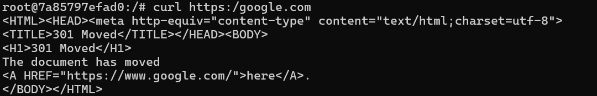
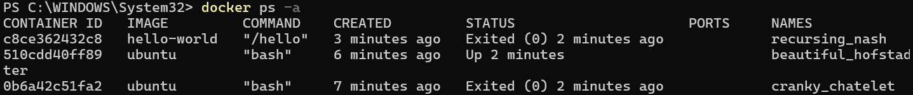
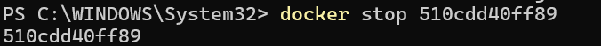
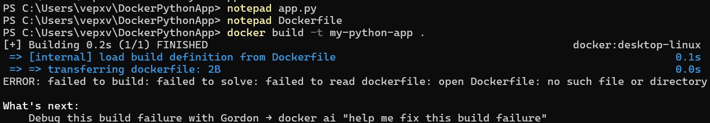
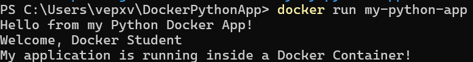
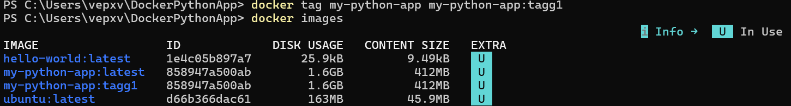
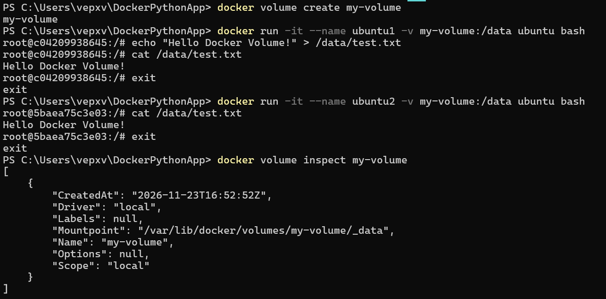
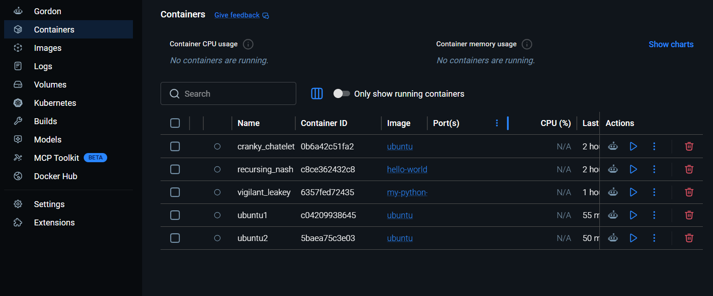
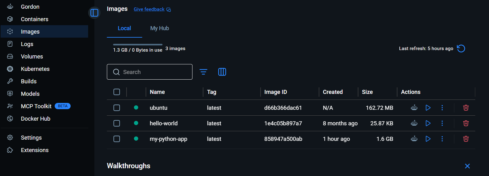
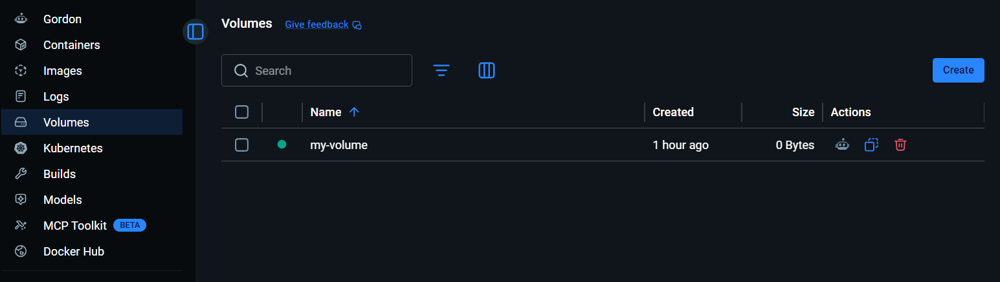

# Docker_DevOps
## ნაწილი 1
hello-world არის სპეციალური docker იმიჯი, რომელსაც ვიყენებთ პროგრამის სისწორის შესამოწმებლად, ანუ სწორად მუშაობს თუ არა ის. თუ აღნიშნული image კომპიუტერში არ არის მაშინ docker ავტომატურად ჩამოტვირთავს მას docker hub-დან,შექმნის კონტეინერს და გაუშვებს. თუმცა მანამდე მე გამოვიყენე docker pull hello-world კომანდი, შესაბამისად ავტომატური ამოტვირთვა აღარ დასჭირდა. საბოლოოდ პროგრამა გამოიტანს შეტყობინებას, რომელიც ადასტურებს docker-ის მუშაობის სისწორეს.

## ინტერაქტიული ubuntu კონტეინერის გაშვება
შემდეგ ჩემი მიზანი იყო გამეშვა ინტერაქტიული Ubuntu კონტეინერი, რომელიც შევასრულე შემდეგი ბრძანებით: 

- -i გამოვიყენე, რადგან ის საშუალებას გვაძლევს შევიტანოთ ბრძანებები კონტეინერში
- -t გამოვიყენე, რადგან შემექმნა ტერმინალის ინტერფეისი

საბოლოოდ ამ ბრძანების საშუალებით შევძელი Linux გარემოში მუშაობა ისე, რომ ubuntu დაინსტალირებული არ მქონდა
## curl ინსტალაცია
curl-ის ინსტალაციას სანამ დავიწყებდი, საჭირო იყო apt update ბრძანების გამოყენება, რათა განმეახლებინა ხელმისაწვდომი პაკეტების სია, მხოლოდ ამის შემდეგ დავიწყე მისი ინსტალაცია, გამოვიყენე -y რითაც ავყომატურად დავადასტურებდი ინსტალაციის მოთხოვნას.

## ინტერნეტთან წვდომა
ამის შემდეგ უკვე ვამოწმებთ ინტერნეტთან წვდომას : curl ბრძანებით ვაგზავნით მოთხოვნას მითითებულ ვებსაიტზე(ამ შემთხვევაში google). თუ მივიღებთ HTML კოდს ან სერვერის პასუხს, ესაა დასტური იმისა, რომ კონტეინერს შეუძლია ვებსერვერთან კავშირი.

## კონტეინერიდან გამოსვლა, კონტეინერების სიის გამოტანა, ერთ-ერთი მათგანის გაჩერება და წაშლა
კონტეინერიდან გამოვედი exit ბრძანებით. კონტეინერების სია გამომაქვს როგორც აქტიურების, ისე exited მათგანების, რასაც ვახერხებ -a-ს გამოყენებით:

შემდეგ უკვე აქტიურ კონტეინერს შევაჩერებთ და ვშლით

# ნაწილი 2
## ახალი საქაღალდის შექმნა
ამ ყველაფრის შემდეგ გადავდივარ ჩემს მთავარ საქაღალდეში, ვქმნი ახალ საქაღალდეს DockerPythonApp ჩემს დირექტორიაში და გადავდივარ მის შიგნით:

## მარტივი python სკრიპტი და Dockerfile, (build)Docker image
ვქმნი ახალ სკრიპტებს NotePad-ის დახმარებით, თუმცა ამ დროს შემექმნა პრობლემა, რადგან შექიმნა Dockerfile.txt და არ მაწყობდა, შესაბამისად მომიწია ფაილზე სახელის გადარქმევა და ამის სისწორეს ვამოწმებ dir ბრძანებით, რომ ნამდვილად შეიცვალა სახელი:

ამის შემდეგ ვაწყობ (build)Docker იმიჯს:

app.py არის მარტივი Python პროგრამა, რომელიც ტერმინალში გამოიტანს რამდენიმე შეტყობინებას, ხოლო Dockerfile არის ტექსტური ფაილი, რომელშიც აღწერილია Docker Image-ის შექმნის ინსტრუქციები.
## შექმნილი იმიჯის გაშვება და tag-ის მინიჭება
ბრძანება ქმნის ახალ კონტეინერს my-python-app Image-ის საფუძველზე და უშვებს მას. კონტეინერის გაშვებისას შესრულდება Dockerfile-ში განსაზღვრული CMD ბრძანება, რომელიც ჩვენს Python პროგრამას იწყებს. პროგრამის მიერ გამოტანილი ტექსტი გამოჩნდება ტერმინალში, დასრულების შემდეგ კი კონტეინერი შეჩერდება.

მომდევნო ბრძანებით ვანიჭებთ იმიჯს ახალ tag-ს(tagg1) და საბოლოოდ გამოგვაქვს ყველა იმიჯის სია:

# ნაწილი 3
## volume-ს შექმნა და მასზე ოპერაციები
ვქმნი volume-ს რათა ჩემი მონაცემები კონტეინერის წაშლის ან შეჩერების დროს არ დაიკარგოს. ამჯერად ჩემს volume-ს დავარქვი my-volume. ამის შემდეგ ვქმნი ubuntu1 კონტეინერს და ვაკავშირებ ჩემს ახლად შექმნილ Volume-თან. /data არის კონტეინერის შიგნით არსებული დირექტორია, რომელშიც Volume-ის მონაცემები ხელმისაწვდომია. ამ დირექტორიაში შექმნილი ფაილები ინახება Volume-ში და არ არის დამოკიდებული მხოლოდ კონტეინერის არსებობაზე. შემდეგ echo ბრძანების გამოყენებით ვქმნი ფაილს volume-ში, > სიმბოლო ტექსტს გადაამისამართებს ფაილში და შექმნის ფაილს, თუ ის არ არსებობს. თუ ფაილი უკვე არსებობს, მისი ძველი შიგთავსი ჩანაცვლდება. ამ ბრძანებით იქმნება test.txt ფაილი /data დირექტორიაში, რომელიც დაკავშირებულია my-volume Volume-თან. ასე შევქმენი ფაილი და საბოლოოდ შევამოწმე მისი სისწორე cat ბრძანებით, ანუ ჩაიწერა თუ არა ფაილში შიგთავსი. შემდეგ გამოვედი კონტეინერიდან და სხვა ubuntu2  კონტეინერში გავუშვი იგივე volume, ანუ, ეს ნიშნავს, რომ ორივე კონტეინერი იყენებს ერთსა და იმავე შენახულ მონაცემებს(პირველ კონტეინერში შექმნილი ფაილი ხელმისაწვდომი უნდა იყოს მეორე კონტეინერშიც). ბოლოს კი ვიყენებ docker volume inspect ბრძანებას, რათა ვნახო volume-ს დეტალური ინფორმაცია:

# საბოლოო ჯამში
## კონტეინერები Docker-ში

## იმიჯები Docker-ში

## Volume-ები Docker-ში

