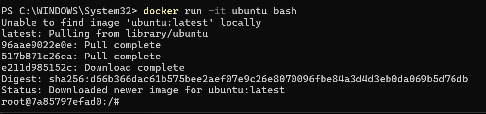
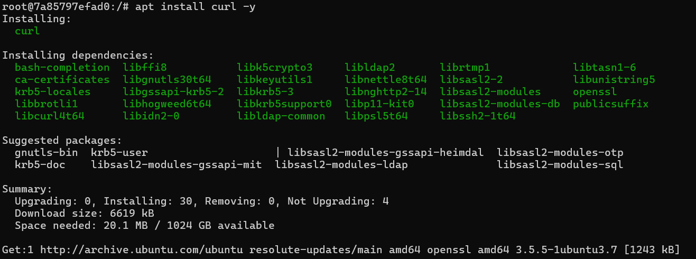
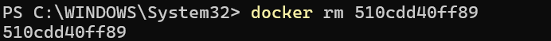
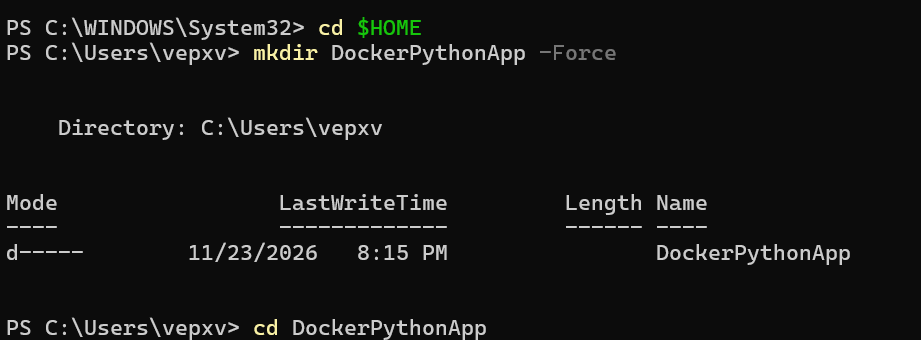
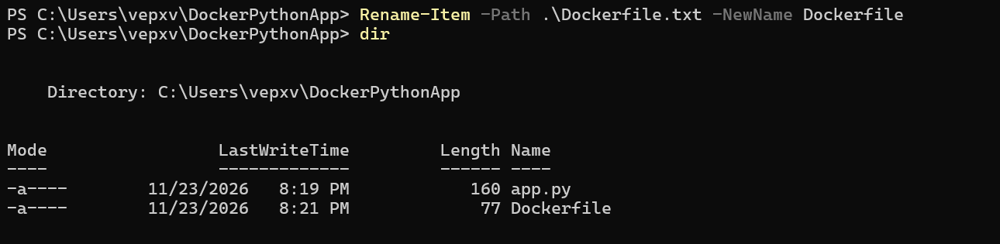

# Docker_DevOps
## ნაწილი 1
hello-world არის სპეციალური docker იმიჯი, რომელსაც ვიყენებთ პროგრამის სისწორის შესამოწმებლად, ანუ სწორად მუშაობს თუ არა ის. თუ აღნიშნული image კომპიუტერში არ არის მაშინ docker ავტომატურად ჩამოტვირთავს მას docker hub-დან,შექმნის კონტეინერს და გაუშვებს. თუმცა მანამდე მე გამოვიყენე docker pull hello-world კომანდი, შესაბამისად ავტომატური ამოტვირთვა აღარ დასჭირდა. საბოლოოდ პროგრამა გამოიტანს შეტყობინებას, რომელიც ადასტურებს docker-ის მუშაობის სისწორეს.

## ინტერაქტიული ubuntu კონტეინერის გაშვება
შემდეგ ჩემი მიზანი იყო გამეშვა ინტერაქტიული Ubuntu კონტეინერი, რომელიც შევასრულე შემდეგი ბრძანებით: 

- -i გამოვიყენე, რადგან ის საშუალებას გვაძლევს შევიტანოთ ბრძანებები კონტეინერში
- -t გამოვიყენე, რადგან შემექმნა ტერმინალის ინტერფეისი

საბოლოოდ ამ ბრძანების საშუალებით შევძელი Linux გარემოში მუშაობა ისე, რომ ubuntu დაინსტალირებული არ მქონდა
## curl ინსტალაცია
curl-ის ინსტალაციას სანამ დავიწყებდი, საჭირო იყო apt update ბრძანების გამოყენება, რათა განმეახლებინა ხელმისაწვდომი პაკეტების სია, მხოლოდ ამის შემდეგ დავიწყე მისი ინსტალაცია, გამოვიყენე -y რითაც ავყომატურად დავადასტურებდი ინსტალაციის მოთხოვნას.

## ინტერნეტთან წვდომა
ამის შემდეგ უკვე ვამოწმებთ ინტერნეტთან წვდომას : curl ბრძანებით ვაგზავნით მოთხოვნას მითითებულ ვებსაიტზე(ამ შემთხვევაში google). თუ მივიღებთ HTML კოდს ან სერვერის პასუხს, ესაა დასტური იმისა, რომ კონტეინერს შეუძლია ვებსერვერთან კავშირი.

## კონტეინერიდან გამოსვლა, კონტეინერების სიის გამოტანა, ერთ-ერთი მათგანის გაჩერება და წაშლა
კონტეინერიდან გამოვედი exit ბრძანებით. კონტეინერების სია გამომაქვს როგორც აქტიურების, ისე exited მათგანების, რასაც ვახერხებ -a-ს გამოყენებით:

შემდეგ უკვე აქტიურ კონტეინერს შევაჩერებთ და ვშლით

# ნაწილი 2
## ახალი საქაღალდის შექმნა
ამ ყველაფრის შემდეგ გადავდივარ ჩემს მთავარ საქაღალდეში, ვქმნი ახალ საქაღალდეს DockerPythonApp ჩემს დირექტორიაში და გადავდივარ მის შიგნით:

## მარტივი python სკრიპტი და Dockerfile, (build)Docker image
ვქმნი ახალ სკრიპტებს NotePad-ის დახმარებით, თუმცა ამ დროს შემექმნა პრობლემა, რადგან შექიმნა Dockerfile.txt და არ მაწყობდა, შესაბამისად მომიწია ფაილზე სახელის გადარქმევა და ამის სისწორეს ვამოწმებ dir ბრძანებით, რომ ნამდვილად შეიცვალა სახელი:

ამის შემდეგ ვაწყობ (build)Docker იმიჯს:

