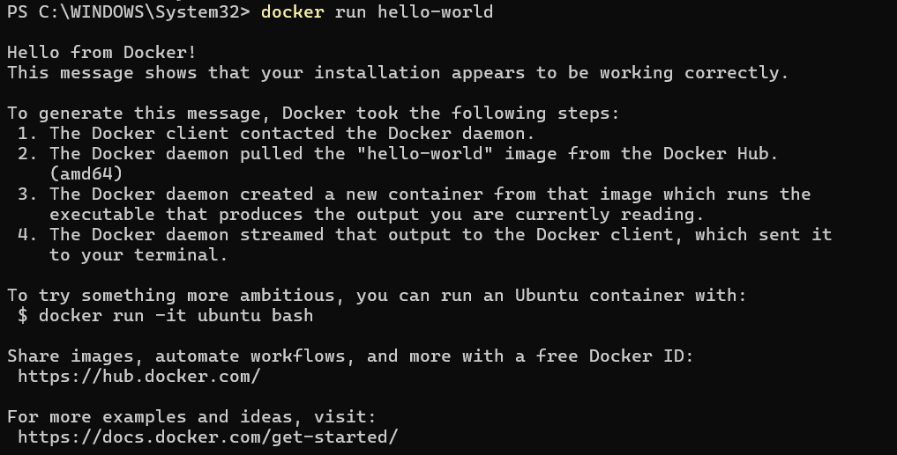

# Docker_DevOps
## ნაწილი 1
hello-world არის სპეციალური docker იმიჯი, რომელსაც ვიყენებთ პროგრამის სისწორის შესამოწმებლად, ანუ სწორად მუშაობს თუ არა ის. თუ აღნიშნული image კომპიუტერში არ არის მაშინ docker ავტომატურად ჩამოტვირთავს მას docker hub-დან,შექმნის კონტეინერს და გაუშვებს. თუმცა მანამდე მე გამოვიყენე docker pull hello-world კომანდი, შესაბამისად ავტომატური ამოტვირთვა აღარ დასჭირდა. საბოლოოდ პროგრამა გამოიტანს შეტყობინებას, რომელიც ადასტურებს docker-ის მუშაობის სისწორეს.

